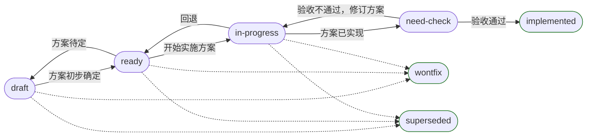
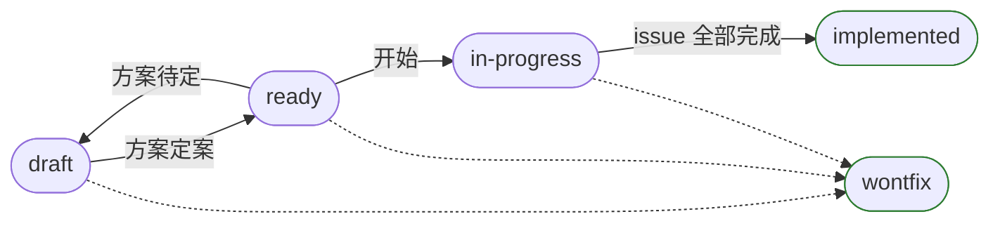

# Triage 标签

## 状态标签全集

可用的全部状态标签如下

| 标签 | issue 含义 | spec 含义 |
| ---- | ---- | ---- |
| `draft` | 尚未确定方案（需要更多信息 / 需要进一步评估） | 尚未确定方案（需要更多信息 / 需要进一步评估） |
| `ready` | 方案已初步确定，待实施 | 方案已初步确定，待拆 issue |
| `in-progress` | 方案实施中 | 实施中 |
| `need-check` | 已实施，待验收 | - |
| `implemented` | 已实施并验收通过 | issue 已全部到达终态 |
| `wontfix` | 不处理 | 不处理 |
| `superseded` | 被取代 | - |

标签写在票文件开头 front matter 的 `status` 键（见 `issue-tracker.md`）
本表与 `scripts/check_tracker_yaml.py` 的词表须一致。

## 状态流转

- 终态为 `implemented` / `wontfix` / `superseded`
- 允许在单次 commit 中推进多次

### issue

### spec

